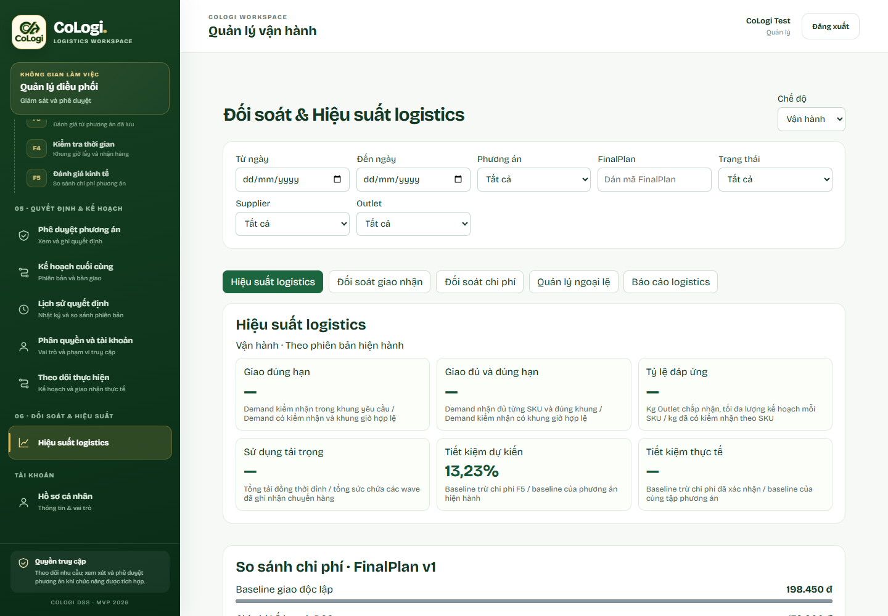

# CoLogi · Collaborative Logistics Decision Support System

CoLogi hỗ trợ lập kế hoạch gom nhu cầu giữa nhà cung cấp, điểm nhận và đơn vị vận chuyển. Bản `v1.0.0` chứa Django REST Framework, React/Vite, PostgreSQL 17 và bản sao phát hành từ database CoLogi đã triển khai.

## Cài đặt cục bộ

Cần Docker với Compose v2. Tạo cấu hình `.env` trên máy cài đặt bằng `./setup.sh` (Linux/macOS) hoặc `./setup.ps1` (PowerShell). Script tạo bốn giá trị bí mật riêng và chạy `docker compose up -d --build --wait`. Nếu đã thiết lập `.env`, có thể chạy lệnh Compose trực tiếp.

Mở [CoLogi](http://127.0.0.1:15173). Cổng này có thể đổi bằng `COLOGI_FRONTEND_PORT`. PostgreSQL và Django chỉ kết nối trong mạng Docker. Xem [tài khoản demo](DEMO_ACCOUNTS.md) và dùng `COLOGI_DEMO_PASSWORD` trong `.env` của bản cài. `admin@cologi.local` giữ quyền quản trị kỹ thuật của tài khoản demo gốc. Bản cài được thiết kế cho chạy cục bộ.

### GitHub Codespaces

Mở **Code → Codespaces → Create codespace**. `.devcontainer` chạy setup khi môi trường khởi động. Trong **Ports**, mở frontend `15173` hoặc backend `18000` và giữ cả hai ở trạng thái **Private**. PostgreSQL `5432` chỉ có trong mạng Compose. Volume được giữ khi dừng và mở lại cùng Codespace.

Kiểm tra `docker compose ps`, sau đó mở `/api/health/ready/` qua frontend và đăng nhập bằng một tài khoản trong `DEMO_ACCOUNTS.md`. Nghiệm thu restart bằng cách tạo một bản ghi thử trong Codespace, chạy `docker compose restart` và kiểm tra bản ghi vẫn còn.

### Dữ liệu khởi tạo và khôi phục

PostgreSQL kiểm SHA-256 rồi khôi phục `database/cologi.dump` khi volume còn trống. Trình cài kiểm trạng thái migration, cấp ACL runtime từ `database/runtime_acl.sql` và chỉ đặt mật khẩu cho các tài khoản demo đang có mật khẩu vô hiệu. `docker compose restart` tiếp tục dùng volume hiện hữu. `database/schema.sql` là bản mô tả schema để tra cứu. Dùng dump để phục hồi dữ liệu và sequences. Xem [manifest](database/database_manifest.json) và [từ điển dữ liệu](docs/data-dictionary.md).

## Nghiệp vụ

- CP04–CP07 gồm Demand, xác nhận của Supplier và cấu hình Provider.
- CP08 DSS gồm F1 lọc Demand và phát hiện nhóm, F2 xây phương án Direct/Hub, F3 kiểm tải và phân bổ phương tiện, F4 kiểm thời gian, F5 tính chi phí và so với baseline.
- CP09–CP10 gồm phê duyệt, FinalPlan theo phiên bản và bàn giao theo quyền.
- CP11 gồm giữ chỗ và ledger theo SKU, lấy hàng, vận chuyển, kiểm nhận và mô phỏng có cách ly.
- CP12 gồm F6 đối soát kế hoạch với thực tế, xử lý ngoại lệ, duyệt chi phí, KPI, báo cáo và đóng FinalPlan. Manager có thể hủy cam kết CP06 khi Demand thật sự hết phương án hợp lệ.

Xem [hướng dẫn theo vai trò](docs/user-guide.md) và [API](docs/api.md). F1 dùng giờ Việt Nam và loại nhu cầu đã hết khung giao hoặc đã có FinalPlan hiệu lực.

## Nguồn dữ liệu và mô phỏng

Dataset V7 và Supplement cung cấp dữ liệu tổng hợp cho Capstone. `database/database_manifest.json` lưu checksum và phạm vi đã làm sạch. Dữ liệu mô phỏng có provenance riêng và các thao tác thương mại vẫn chịu `COMMERCIAL_EVIDENCE_REQUIRED`. Ngày của Demand, FinalPlan và snapshot lịch sử được giữ nguyên. Xem hướng dẫn cấp dữ liệu mô phỏng cho ngày mới trong [User Guide](docs/user-guide.md).

## Xử lý sự cố

- Xem `docker compose ps` và `docker compose logs db bootstrap backend frontend`. Nếu bootstrap báo migration chưa áp dụng, kiểm tra tag source và checksum dump.
- Nếu localhost báo cổng đã dùng, đổi `COLOGI_FRONTEND_PORT` rồi chạy `docker compose up -d`.
- Nếu khôi phục lần đầu bị lỗi, giữ volume để kiểm tra log. Dùng volume mới chỉ khi đã quyết định khởi tạo lại bản cài cục bộ.
- Các tài khoản giữ quyền gốc theo Outlet, đơn vị và context. Chọn đúng tài khoản khi không thấy chức năng hoặc Demand.
